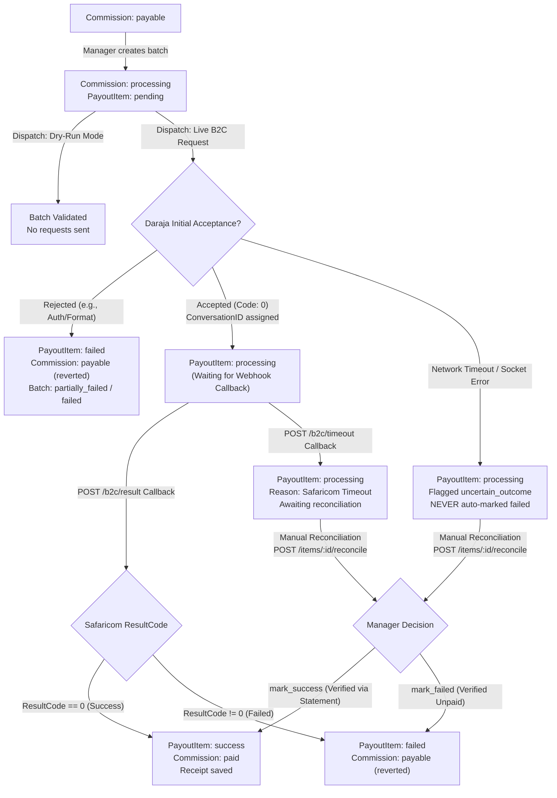

# Soya Ventures - Project State & Architecture Documentation

**Last Updated:** 2026-10-21 (Task 5 Completed: Safaricom Daraja B2C Sandbox Payouts)  
**Project Path:** `/home/swe-dev/Projects/Flutter_app/Soya_Ventures`  
**Purpose:** Single source of truth for developers and AI agents to continue work seamlessly.

---

## 1. Executive Summary & Objective

Soya Ventures is a multi-platform sales, inventory, downline referral commission, and M-Pesa payout management system.
- **Frontend:** Flutter mobile/desktop app (`SoyaVentures/`).
- **Backend:** Node.js, Express 5, PostgreSQL (`pg` connection pool), `dotenv`, `bcryptjs`, `jsonwebtoken`.
- **Target Roles:**
  1. `admin`: Global configuration, financials, creating privileged accounts, payout authorization, product/center management.
  2. `manager`: Regional oversight, restocking approvals, payout batch initiation and reconciliation, analytics.
  3. `center`: Center Hub Operator holding local inventory, receiving restocking, fulfilling agent stock requests.
  4. `agent`: Direct sales force, picks up inventory, records sales, earns direct commissions and 1-tier downline referral overrides.

---

## 2. Technology Stack & Database Migrations

- **Node.js:** v24.21.0 | **npm:** 11.19.0
- **PostgreSQL:** Running on port 5432, accepting connections.
- **Migrations Applied (`backend/Database/migrations/`):**
  1. `001_initial_baseline.sql`: Core baseline tables.
  2. `002_users_and_referrals.sql`: Phone number, active flags, referral constraints.
  3. `003_inventory_and_orders.sql`: Order types, audit timestamps, stock movements ledger.
  4. `004_payouts_ledger.sql`: Payout batches, payout items, commission status, duplicate payout prevention.
  5. `005_audit_logs.sql`: Audit logs with secret scrubbing check constraints.
  6. `006_performance_indexes.sql`: Foreign keys, status columns, and timestamp indexes.
  7. `007_create_order_items.sql`: Multi-product line items table (`order_items`), header enhancements (`orders.total_amount`, `orders.center_id`), and product base commission (`products.commission_per_unit`).

---

## 3. Business API Endpoints Reference

### 3.1 Product Catalog (`/api/products`)

| Method | Endpoint | Access Role | Description |
| :--- | :--- | :--- | :--- |
| `GET` | `/api/products` | Public / Auth | List active products (Admins can pass `?include_inactive=true`) |
| `GET` | `/api/products/:id` | Public / Auth | Retrieve single product details |
| `POST` | `/api/products` | `admin` | Create product (`name`, `price > 0`, `sku`, `commission_per_unit`) |
| `PUT` | `/api/products/:id` | `admin` | Update product details |
| `DELETE` | `/api/products/:id` | `admin` | Soft-deactivate product (`is_active = false`) |

### 3.2 Centers & Hub Inventory (`/api/centers` & `/api/inventory`)

| Method | Endpoint | Access Role | Description |
| :--- | :--- | :--- | :--- |
| `GET` | `/api/centers` | Auth | List centers |
| `GET` | `/api/centers/:id` | Auth | Center hub details |
| `POST` | `/api/centers` | `admin` | Create new center hub (`name`, `location`, `contact_phone`) |
| `PUT` | `/api/centers/:id` | `admin` | Update center hub details |
| `DELETE` | `/api/centers/:id` | `admin` | Soft-deactivate center hub |
| `GET` | `/api/inventory` | Scoped | View stock for permitted center (Admin/Manager any center; Agent/Center confined to assigned hub) |
| `GET` | `/api/inventory/center/:centerId` | Scoped | View stock for specific center (scoped) |
| `GET` | `/api/inventory/center/:centerId/product/:productId` | Scoped | View single product quantity at center |
| `POST` | `/api/inventory/restock` | `admin`, `manager` | Restock center inventory with atomic transaction and `stock_movements` ledger entry |

### 3.3 Hierarchical Multi-Item Orders (`/api/orders`)

| Method | Endpoint | Access Role | Description |
| :--- | :--- | :--- | :--- |
| `POST` | `/api/orders` | `agent`, `center` | Create hierarchical multi-item order (`items: [{ product_id, quantity }]`) |
| `GET` | `/api/orders` | Scoped | List orders (Agent sees own; Center sees hub; Manager sees replenishments; Admin sees all) |
| `GET` | `/api/orders/:id` | Scoped | Get order details with line items |
| `PUT` | `/api/orders/:id/status` | Scoped Reviewer | Transition order status (`approved`, `rejected`, `fulfilled`, `cancelled`) |

**Order Hierarchy & Concurrency Rules:**
1. **Agent-to-Center (`agent_to_center`):**
   - Placed by `agent` to restock from their assigned center hub.
   - Status transitions: `pending` $\rightarrow$ `approved` $\rightarrow$ `fulfilled`.
   - **Self-Approval Forbidden:** An agent cannot approve or fulfill their own order.
   - Reviewer must be `center` operator for that hub or `admin`/`manager`.
   - On fulfillment, center stock is locked with `SELECT ... FOR UPDATE` and deducted. Fails with `400 INSUFFICIENT_STOCK` if hub balance is lower than requested.
2. **Center-to-Manager (`center_to_manager`):**
   - Placed by `center` operator requesting replenishment from a manager.
   - Reviewer must be `manager` or `admin`.
   - On fulfillment, stock is added to the center hub and recorded in `stock_movements`.

### 3.4 Sales & Commission Engine (`/api/sales` & `/api/commissions`)

| Method | Endpoint | Access Role | Description |
| :--- | :--- | :--- | :--- |
| `POST` | `/api/sales` | `agent` | Record product sale, deduct center stock atomically, generate commissions |
| `GET` | `/api/sales` | Scoped | List sales (Agent sees own; Center sees hub; Admin/Manager sees all) |
| `GET` | `/api/commissions` | Scoped | List commissions (Agent sees own; Admin/Manager sees all) |

**Sales & Commission Business Rules:**
- **Trusted Pricing:** Client-supplied prices and commission figures are strictly ignored. Product unit price is loaded directly from PostgreSQL with row lock (`FOR UPDATE`).
- **Inventory Source:** Stock is automatically verified and deducted from the agent's assigned Center Hub (`users.center_id`).
- **Direct Commission:** Calculated as a fixed rate per unit sold (e.g. `agent.commission_rate * quantity` or falling back to `product.commission_per_unit * quantity`, default 50.00 KES/unit).
- **1-Level Recruiter Override Bonus:** If the selling agent was recruited by an active uplink agent (`users.recruiter_id`), an override commission of **5% of the total sale amount** is awarded to the recruiter.
- **Single-Tier Override Limit:** Enforced by PostgreSQL unique index `uq_commissions_sale_type (sale_id, type)` preventing multi-tier override creep.

---

## 4. Safaricom Daraja B2C Payout Integration

### 4.1 Payout Endpoints Reference (`/api/payouts`)

| Method | Endpoint | Access Role | Description |
| :--- | :--- | :--- | :--- |
| `POST` | `/api/payouts/batches` | `manager`, `admin` | Create payout batch bundling eligible `payable` commissions. |
| `GET` | `/api/payouts/batches` | `manager`, `admin` | List payout batches with totals, counts, and statuses. |
| `GET` | `/api/payouts/batches/:id` | `manager`, `admin` | Retrieve batch details and line items with Daraja references. |
| `POST` | `/api/payouts/batches/:id/process` | `manager`, `admin` | Dispatch batch to Daraja (`?dry_run=true` validates without sending). |
| `POST` | `/api/payouts/items/:id/reconcile` | `manager`, `admin` | Reconcile missing or timed-out payout items (`mark_success` or `mark_failed`). |
| `POST` | `/api/payouts/b2c/result` | Webhook (Safaricom) | Webhook handling Daraja B2C final transaction outcomes. |
| `POST` | `/api/payouts/b2c/timeout` | Webhook (Safaricom) | Webhook receiving Safaricom queue/routing timeout notices. |

---

### 4.2 Payout Lifecycle State Machine



---

### 4.3 Sandbox Shortcode Verification & Clarification

> [!IMPORTANT]
> **Shortcode `174379` vs `600988` Analysis:**
> - In Safaricom's Daraja Sandbox, shortcode **`174379`** is the standard **C2B (Customer to Business / Lipa Na M-Pesa Online STK Push)** paybill number. It is configured to *receive* customer funds, **not** disburse outbound business funds.
> - Attempting to initiate a B2C payment (`/mpesa/b2c/v1/paymentrequest`) using shortcode `174379` will be rejected by Safaricom's API gateway with an invalid shortcode or initiator error.
> - The standard, officially supported Safaricom Daraja Sandbox **B2C Shortcode is `600988`** (with initiator name `testapi` and command ID `BusinessPayment` or `SalaryPayment`).
> - **Configuration Resolution:** The backend supports both through the `MPESA_B2C_SHORTCODE` environment variable in `backend/config/env.js` and `.env.example`. It defaults cleanly to `600988` while allowing exact override via `.env`.

---

### 4.4 Daraja Security, Idempotency & Reconciliation Design

1. **Manager Authorization:** Only users with `manager` or `admin` roles can create, inspect, process, or reconcile payout batches.
2. **Duplicate Payout Protection:**
   - When a batch is created, all associated commission records are transactionally transitioned from `payable` to `processing`.
   - PostgreSQL unique index `uq_payout_items_active_commission` guarantees no commission can appear in multiple active payout batches.
3. **Controlled Concurrency:**
   - Line items within a batch are processed concurrently using configurable concurrency limits (`concurrency` parameter, default 2, max 5).
   - Prevents outbound connection exhaustion and API gateway throttling.
4. **Strict Distinction Between Definite Failures and Uncertain Outcomes:**
   - Network dropouts, socket timeouts, and gateway resets are classified as `UNCERTAIN`. The item remains in `processing` and is flagged in failure reasons.
   - The system **never** marks an uncertain payout as `failed` (which would unsafely revert commissions to `payable` and risk double-paying if Safaricom's upstream pipeline completed).
5. **Idempotent Webhook Processing:**
   - Webhooks received at `/api/payouts/b2c/result` match items by `ConversationID` and `OriginatorConversationID`.
   - Repeated callbacks for already completed/failed items are detected and safely acknowledged without modifying state or re-firing side effects.
   - Unmatched callbacks are recorded in an isolated quarantine structure to prevent silent data corruption.
6. **Reconciliation Mechanism:**
   - In case of network timeout or missing Safaricom callbacks, managers can check Safaricom's portal and use `POST /api/payouts/items/:id/reconcile` with the confirmed M-Pesa receipt number (`mark_success`) or mark it `mark_failed` to release the commission for a future payout run.

---

## 5. Verification & Automated Test Results

The backend contains 56 automated integration tests across 17 test suites:

```bash
$ npm test --prefix backend

▶ Database Schema & Constraint Verification (6 tests passing)
  ✔ All migrations are marked as applied in schema_migrations
  ✔ All expected tables exist in public schema
  ✔ User self-referral constraint prevents user from recruiting themselves
  ✔ Commissions table strictly limits sales to at most 1 direct and 1 override commission
  ✔ Payout items cannot include the same commission in multiple active payouts
  ✔ Audit log table rejects credentials and passwords in new_values and old_values

▶ Authentication, Validation, RBAC & Rate Limiting (17 tests passing)
  ✔ Input validation (name, email, password, MSISDN phone)
  ✔ Public registration role enforcement (strictly forces 'agent')
  ✔ Conflict handling (duplicate email/phone)
  ✔ JWT authentication and profile extraction (/api/auth/me)
  ✔ RBAC administrative user creation (/api/users)
  ✔ Rate limiting protection (429 Too Many Requests)

▶ Soya Ventures Business APIs (17 tests passing)
  ✔ Product creation, duplicate SKU rejection, price updates, deactivation
  ✔ Center creation and scoped inventory access (cross-center access forbidden)
  ✔ Administrative center restocking and audit ledger tracking
  ✔ Multi-line orders (agent_to_center), self-approval prevention (403)
  ✔ Concurrency control & insufficient stock rejection on fulfillment
  ✔ Sales processing with trusted DB prices (client spoofed prices ignored)
  ✔ Automatic direct commission + 5% 1-tier recruiter override calculation
  ✔ Scoped commission visibility

▶ Health & Database Readiness Endpoints (3 tests passing)
  ✔ GET /api/health returns 200 with API status
  ✔ GET /api/health/db returns 200 with database latency
  ✔ Unrecognized endpoints return 404 JSON

▶ Safaricom Daraja B2C Payouts & Reconciliation (13 tests passing)
  ✔ Agent role rejected when attempting to create payout batch (403 Forbidden)
  ✔ Manager successfully creates payout batch from eligible payable commissions
  ✔ Duplicate prevention: Ineligible / already-processing commissions rejected
  ✔ Dry-run mode validates batch without sending funds or modifying item statuses
  ✔ Live batch dispatch: Daraja acceptance transitions items to processing (not success)
  ✔ Network timeout handling: Items remain in processing without premature failure
  ✔ Unmatched callback quarantined safely without corrupting records
  ✔ Success callback marks payout item success and marks commission paid
  ✔ Repeated / duplicate callback handled idempotently without error
  ✔ Failed callback marks payout item failed and reverts commission to payable
  ✔ Manager manual reconciliation for missing/timed-out callbacks

ℹ tests 56 | suites 17 | pass 56 | fail 0 | cancelled 0 | skipped 0
```

---

## 6. Safaricom Sandbox Testing Guide

To test with Safaricom Daraja Sandbox:
1. Copy `backend/.env.example` to `backend/.env` (if not already set up).
2. Configure Daraja credentials:
   ```env
   MPESA_ENVIRONMENT=sandbox
   MPESA_CONSUMER_KEY=your_sandbox_consumer_key
   MPESA_CONSUMER_SECRET=your_sandbox_consumer_secret
   MPESA_B2C_SHORTCODE=600988
   MPESA_INITIATOR_NAME=testapi
   MPESA_SECURITY_CREDENTIAL=your_encrypted_credential_or_test_value
   MPESA_RESULT_URL=https://your-public-ngrok-or-domain.com/api/payouts/b2c/result
   MPESA_TIMEOUT_URL=https://your-public-ngrok-or-domain.com/api/payouts/b2c/timeout
   ```
3. When using a local server with ngrok:
   ```bash
   ngrok http 3000
   ```
   Set `MPESA_RESULT_URL` and `MPESA_TIMEOUT_URL` to your ngrok forwarding URL.
4. Initiate a payout batch with `POST /api/payouts/batches`.
5. Test validation with dry-run: `POST /api/payouts/batches/:id/process?dry_run=true`.
6. Dispatch live batch: `POST /api/payouts/batches/:id/process`.
