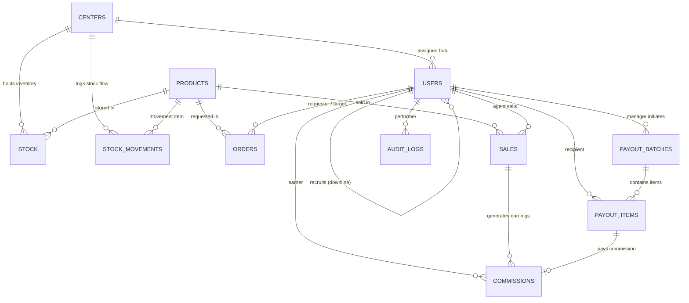

# Soya Ventures - Database Schema & Migrations Reference

This document provides a complete technical guide to the Soya Ventures PostgreSQL schema, relationship model, constraint design, and migration system.

---

## 1. Entity Relationship Model



---

## 2. Table Specifications & Constraints

### 2.1 Centers (`centers`)
Physical or virtual inventory hubs where agents pick up products.
- `id` (SERIAL PRIMARY KEY)
- `name` (VARCHAR(100) NOT NULL): Hub name.
- `location` (VARCHAR(150)): City, neighborhood, or landmark.
- `contact_phone` (VARCHAR(20)): Hub contact number.
- `is_active` (BOOLEAN NOT NULL DEFAULT TRUE): Soft-disable retired hubs.
- `created_at` (TIMESTAMP DEFAULT NOW())
- `updated_at` (TIMESTAMPTZ DEFAULT NOW())

### 2.2 Users (`users`)
System accounts with role segregation and referral linking.
- `id` (SERIAL PRIMARY KEY)
- `full_name` (VARCHAR(100) NOT NULL)
- `email` (VARCHAR(100) UNIQUE NOT NULL)
- `phone_number` (VARCHAR(20) UNIQUE): Safaricom phone number for M-Pesa payouts.
- `password_hash` (VARCHAR(255) NOT NULL): Bcrypt hashed password.
- `role` (VARCHAR(20) NOT NULL DEFAULT 'agent'): Supported roles:
  - `admin`: Global system configuration, financials, user management.
  - `manager`: Oversight, analytics, restocking approval.
  - `center`: Hub operator responsible for local stock and fulfilling agent orders.
  - `agent`: Direct sales agent who orders stock, records sales, and recruits downlines.
- `center_id` (INTEGER REFERENCES centers(id)): Assigned center hub.
- `recruiter_id` (INTEGER REFERENCES users(id)): Uplink agent (1-level referral).
- `commission_rate` (NUMERIC(5,2) DEFAULT 0): Base commission rate %.
- `is_active` (BOOLEAN NOT NULL DEFAULT TRUE)
- `created_at` (TIMESTAMP DEFAULT NOW())
- `updated_at` (TIMESTAMPTZ DEFAULT NOW())
- **Constraints:**
  - `users_role_check`: `CHECK (role IN ('admin', 'manager', 'center', 'agent'))`
  - `users_no_self_referral`: `CHECK (recruiter_id IS NULL OR recruiter_id <> id)`

### 2.3 Products (`products`)
Brand catalog items.
- `id` (SERIAL PRIMARY KEY)
- `sku` (VARCHAR(50) UNIQUE): Stock keeping unit identifier.
- `name` (VARCHAR(100) NOT NULL)
- `price` (NUMERIC(10,2) NOT NULL CHECK (price > 0))
- `is_active` (BOOLEAN NOT NULL DEFAULT TRUE)
- `created_at` (TIMESTAMP DEFAULT NOW())
- `updated_at` (TIMESTAMPTZ DEFAULT NOW())

### 2.4 Stock (`stock`)
Current inventory balance per center hub.
- `center_id` (INTEGER REFERENCES centers(id))
- `product_id` (INTEGER REFERENCES products(id))
- `quantity` (INTEGER NOT NULL DEFAULT 0 CHECK (quantity >= 0))
- **Primary Key:** `(center_id, product_id)`

### 2.5 Stock Movements (`stock_movements`)
Immutable inventory audit ledger tracking all additions, deductions, and transfers.
- `id` (SERIAL PRIMARY KEY)
- `center_id` (INTEGER REFERENCES centers(id) NOT NULL)
- `product_id` (INTEGER REFERENCES products(id) NOT NULL)
- `change_quantity` (INTEGER NOT NULL CHECK (change_quantity <> 0)): Positive for restock/returns, negative for sales/fulfillments.
- `balance_after` (INTEGER NOT NULL CHECK (balance_after >= 0))
- `movement_type` (VARCHAR(30) NOT NULL): `initial`, `restock`, `order_fulfillment`, `order_receipt`, `sale`, `adjustment`, `return`.
- `reference_type` (VARCHAR(30)): `order`, `sale`, `manual`, `transfer`.
- `reference_id` (INTEGER): Linked ID of the order or sale.
- `performed_by` (INTEGER REFERENCES users(id))
- `notes` (TEXT)
- `created_at` (TIMESTAMPTZ DEFAULT NOW())

### 2.6 Orders (`orders`)
Hierarchical restocking requests (Agent $\rightarrow$ Center, Center $\rightarrow$ Manager).
- `id` (SERIAL PRIMARY KEY)
- `order_type` (VARCHAR(30) NOT NULL DEFAULT 'agent_to_center'): `agent_to_center` or `center_to_manager`.
- `requester_id` (INTEGER REFERENCES users(id) NOT NULL)
- `target_id` (INTEGER REFERENCES users(id) NOT NULL)
- `product_id` (INTEGER REFERENCES products(id) NOT NULL)
- `quantity` (INTEGER NOT NULL CHECK (quantity > 0))
- `status` (VARCHAR(20) NOT NULL DEFAULT 'pending'): `pending`, `approved`, `rejected`, `fulfilled`, `cancelled`.
- `approved_by` (INTEGER REFERENCES users(id))
- `approved_at` (TIMESTAMPTZ)
- `fulfilled_at` (TIMESTAMPTZ)
- `notes` (TEXT)
- `created_at` (TIMESTAMP DEFAULT NOW())
- `updated_at` (TIMESTAMPTZ DEFAULT NOW())

### 2.7 Sales (`sales`)
Direct sales recorded by agents.
- `id` (SERIAL PRIMARY KEY)
- `agent_id` (INTEGER REFERENCES users(id) NOT NULL)
- `center_id` (INTEGER REFERENCES centers(id)): Hub inventory source.
- `product_id` (INTEGER REFERENCES products(id) NOT NULL)
- `quantity` (INTEGER NOT NULL CHECK (quantity > 0))
- `unit_price` (NUMERIC(10,2) CHECK (unit_price IS NULL OR unit_price > 0)): Snapshot price at time of transaction.
- `total` (NUMERIC(10,2) NOT NULL CHECK (total > 0))
- `customer_phone` (VARCHAR(20))
- `created_at` (TIMESTAMP DEFAULT NOW())

### 2.8 Commissions (`commissions`)
Direct sales commissions and recruiter overrides.
- `id` (SERIAL PRIMARY KEY)
- `sale_id` (INTEGER REFERENCES sales(id) NOT NULL)
- `earner_id` (INTEGER REFERENCES users(id) NOT NULL)
- `type` (VARCHAR(10) NOT NULL CHECK (type IN ('direct', 'override')))
- `amount` (NUMERIC(10,2) NOT NULL CHECK (amount > 0))
- `status` (VARCHAR(20) NOT NULL DEFAULT 'payable'): `pending`, `payable`, `processing`, `paid`, `cancelled`.
- `payout_item_id` (INTEGER REFERENCES payout_items(id) ON DELETE SET NULL)
- `created_at` (TIMESTAMP DEFAULT NOW())
- `updated_at` (TIMESTAMPTZ DEFAULT NOW())
- **Constraint:**
  - `uq_commissions_sale_type`: `UNIQUE (sale_id, type)`. **Enforces maximum of 1 direct commission and 1 recruiter override per sale.**

### 2.9 Payout Batches (`payout_batches`)
Batch disbursement envelope initiated by managers/finance.
- `id` (SERIAL PRIMARY KEY)
- `batch_reference` (VARCHAR(64) UNIQUE NOT NULL): Internal batch tracking number.
- `initiating_manager_id` (INTEGER REFERENCES users(id) NOT NULL)
- `status` (VARCHAR(25) NOT NULL DEFAULT 'draft'): `draft`, `pending`, `processing`, `completed`, `partially_completed`, `failed`, `cancelled`.
- `total_amount` (NUMERIC(12,2) NOT NULL DEFAULT 0.00 CHECK (total_amount >= 0))
- `item_count` (INTEGER NOT NULL DEFAULT 0 CHECK (item_count >= 0))
- `currency` (VARCHAR(3) NOT NULL DEFAULT 'KES')
- `notes` (TEXT)
- `created_at` (TIMESTAMPTZ DEFAULT NOW())
- `updated_at` (TIMESTAMPTZ DEFAULT NOW())
- `completed_at` (TIMESTAMPTZ)

### 2.10 Payout Items (`payout_items`)
Line items dispatched to recipients via Safaricom Daraja M-Pesa B2C.
- `id` (SERIAL PRIMARY KEY)
- `batch_id` (INTEGER REFERENCES payout_batches(id) ON DELETE RESTRICT NOT NULL)
- `recipient_id` (INTEGER REFERENCES users(id) NOT NULL)
- `phone_number` (VARCHAR(20) NOT NULL): Recipient Safaricom MSISDN (`2547XXXXXXXX`).
- `commission_id` (INTEGER REFERENCES commissions(id) ON DELETE RESTRICT)
- `amount` (NUMERIC(10,2) NOT NULL CHECK (amount > 0))
- `currency` (VARCHAR(3) NOT NULL DEFAULT 'KES')
- `payout_reference` (VARCHAR(64) UNIQUE NOT NULL): Unique disbursement code.
- `originator_conversation_id` (VARCHAR(100)): Daraja request identifier.
- `conversation_id` (VARCHAR(100)): Daraja tracking ID.
- `transaction_id` (VARCHAR(100)): M-Pesa receipt code (e.g., `NLJ7RT61SV`).
- `status` (VARCHAR(20) NOT NULL DEFAULT 'pending'): `pending`, `processing`, `success`, `failed`.
- `result_code` (INTEGER): Safaricom response code (`0` for success).
- `result_desc` (TEXT)
- `raw_callback` (JSONB): Full Daraja callback payload.
- `created_at` (TIMESTAMPTZ DEFAULT NOW())
- `updated_at` (TIMESTAMPTZ DEFAULT NOW())
- `processed_at` (TIMESTAMPTZ)
- **Constraint:**
  - `uq_payout_items_active_commission`: `UNIQUE (commission_id) WHERE commission_id IS NOT NULL AND status IN ('pending', 'processing', 'success')`. **Guarantees a commission can never be paid twice or attached to multiple active payouts.**

### 2.11 Audit Logs (`audit_logs`)
System-wide administrative and financial audit log.
- `id` (BIGSERIAL PRIMARY KEY)
- `user_id` (INTEGER REFERENCES users(id) ON DELETE SET NULL)
- `action` (VARCHAR(50) NOT NULL)
- `entity_type` (VARCHAR(50) NOT NULL)
- `entity_id` (VARCHAR(64))
- `old_values` (JSONB)
- `new_values` (JSONB)
- `ip_address` (VARCHAR(45))
- `user_agent` (TEXT)
- `created_at` (TIMESTAMPTZ DEFAULT NOW())
- **Security Constraints:**
  - `audit_no_secrets_in_new_values` & `audit_no_secrets_in_old_values`: Validates that JSON keys `password`, `password_hash`, `token`, `access_token`, `secret`, and `security_credential` cannot be stored in audit records.

---

## 3. Migration Runner & Operations Guide

### 3.1 Migration Commands
From the `backend` directory (or workspace root with `--prefix backend`):
```bash
# 1. Check current migration status
npm run migrate:status

# 2. Preview pending migrations without applying
npm run migrate:dry-run

# 3. Apply all pending migrations safely within transactions
npm run migrate

# 4. Run automated migration and schema constraint test suite
npm test
```

### 3.2 Database Backup and Restoration
To safely back up and restore the PostgreSQL database:
```bash
# Backup command (creates compressed binary dump)
pg_dump -U $DB_USER -h $DB_HOST -p $DB_PORT -d $DB_NAME -F c -b -v -f soya_backup_$(date +%Y%m%d_%H%M%S).dump

# Restore command (preserves constraints and data)
pg_restore -U $DB_USER -h $DB_HOST -p $DB_PORT -d $DB_NAME -v soya_backup_<timestamp>.dump
```

